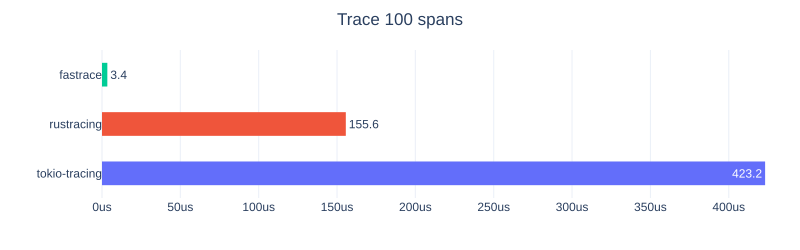

# Fastrace Documentation

These guides are adapted from the upstream README at [`45e58b94264dd2134b4b08be36f8378a4539bb50`](https://github.com/fast/fastrace/blob/45e58b94264dd2134b4b08be36f8378a4539bb50/README.md). Package links, examples, and benchmark results describe upstream Fastrace. See the [project overview](../README.md) for the Beacon maintenance scope.

Fastrace is a tracing library [100x faster](benchmarks.md) than others:

Features:

- [Extremely fast](benchmarks.md)
- [Rich features for logging](../examples/log-integration/main.rs)
- Compatible with [OpenTelemetry](https://opentelemetry.io/)

## Guides

- [Getting started](getting-started.md): library and application instrumentation, initialization, and supported Rust versions.
- [Reporters and integrations](integrations.md): OpenTelemetry export, framework integrations, and projects using Fastrace.
- [Migrating from tokio-tracing](migrating-from-tracing.md): the Fastrace compatibility layer.
- [Frequently asked questions](faq.md): performance design and tracing concepts.
- [Benchmarks](benchmarks.md): upstream results by architecture and span count.

## Resources

- [API documentation](https://docs.rs/fastrace/)
- [Examples](../examples)
- [Contribution guide](../CONTRIBUTING.md)
- [Upstream baseline and synchronization](../beacon/UPSTREAM.md)

## License

This project is licensed under the [Apache-2.0](../LICENSE) license.

Upstream Fastrace originated as a fork of [minitrace](https://github.com/tikv/minitrace-rust/). See this thread for more information:

* [Running minitrace as a standalone project?](https://github.com/tikv/minitrace-rust/issues/229)
