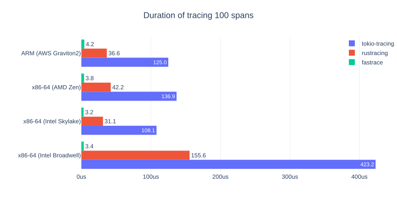
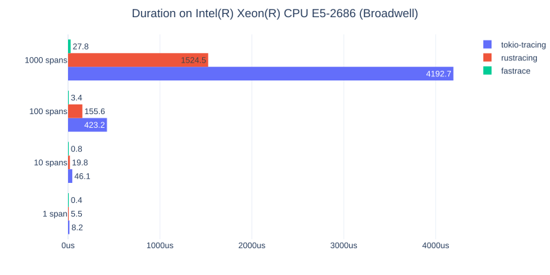

# Benchmarks

**By different architectures:**

|                     | x86-64 (Intel Broadwell) | x86-64 (Intel Skylake) | x86-64 (AMD Zen) | ARM (AWS Graviton2) |
|---------------------|--------------------------|------------------------|------------------|---------------------|
| tokio-tracing       | 124x slower              | 33x slower             | 36x slower       | 29x slower          |
| rustracing          | 45x slower               | 10x slower             | 11x slower       | 9x slower           |
| fastrace (baseline) | 1x (3.4us)               | 1x (3.2us)             | 1x (3.8us)       | 1x (4.2us)          |

**By creating a different number of spans:**

|                     | 1 span     | 10 spans   | 100 spans   | 1000 spans  |
|---------------------|------------|------------|-------------|-------------|
| tokio-tracing       | 19x slower | 61x slower | 124x slower | 151x slower |
| rustracing          | 13x slower | 26x slower | 45x slower  | 55x slower  |
| fastrace (baseline) | 1x (0.4us) | 1x (0.8us) | 1x (3.4us)  | 1x (27.8us) |

Detailed results are available in [benches/results](../benches/results).

[Documentation index](README.md)
